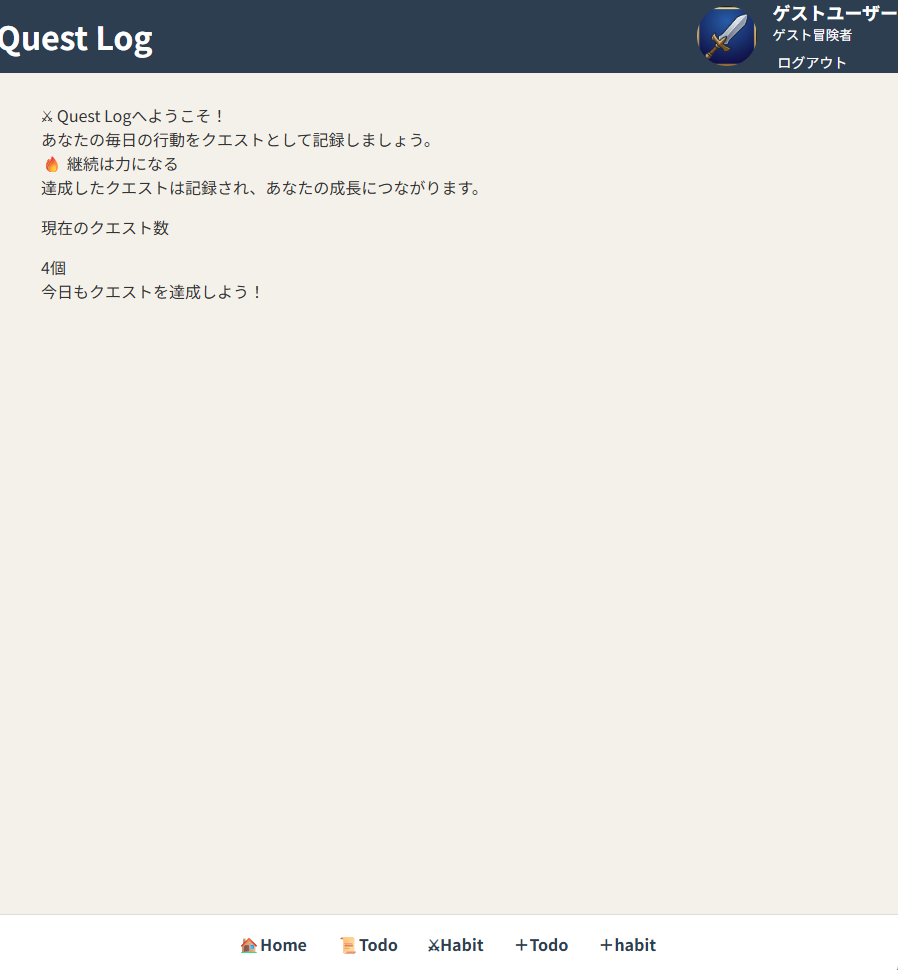
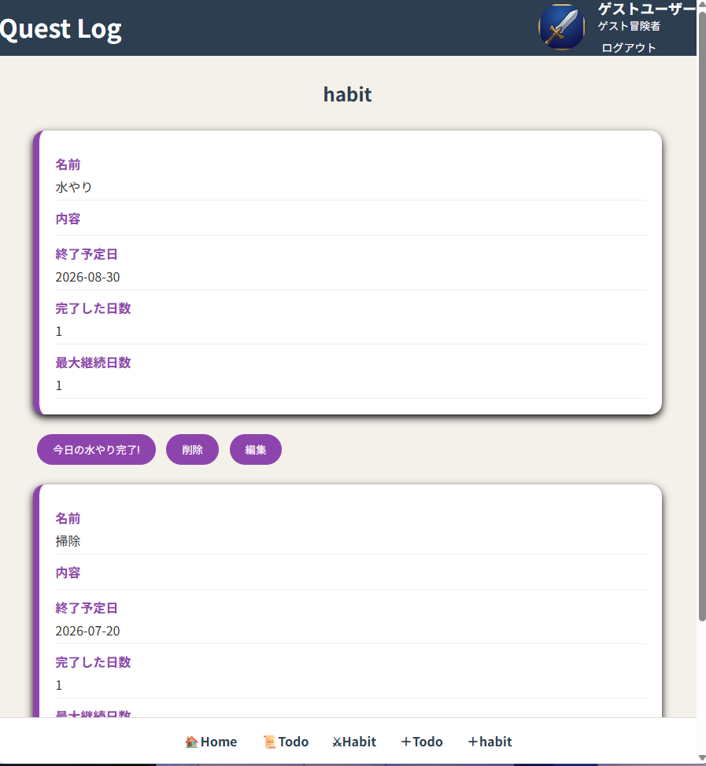
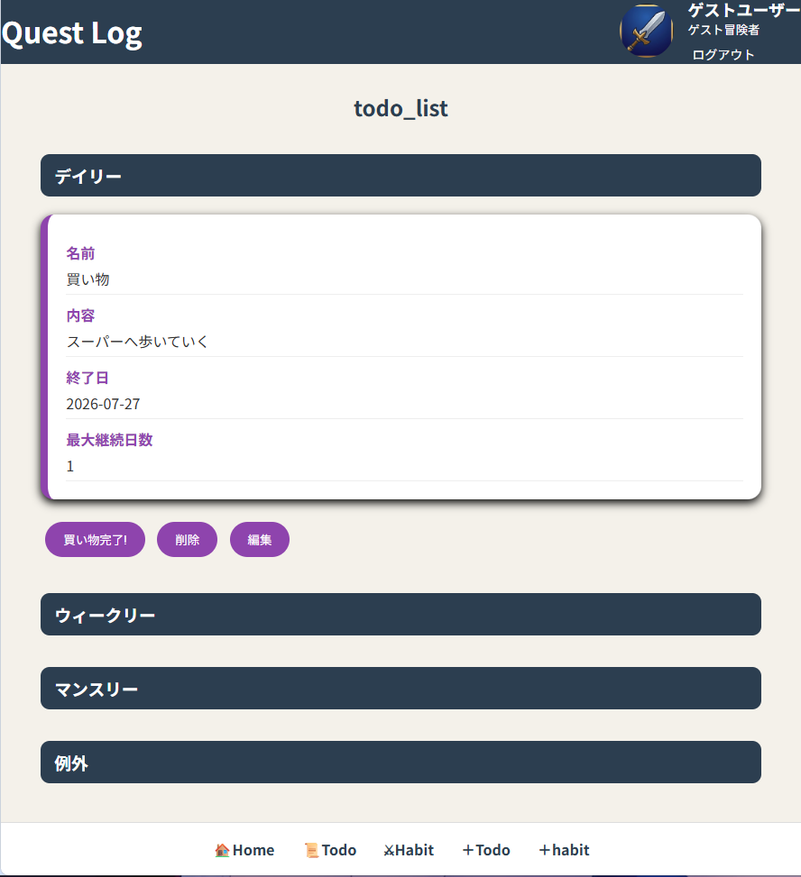
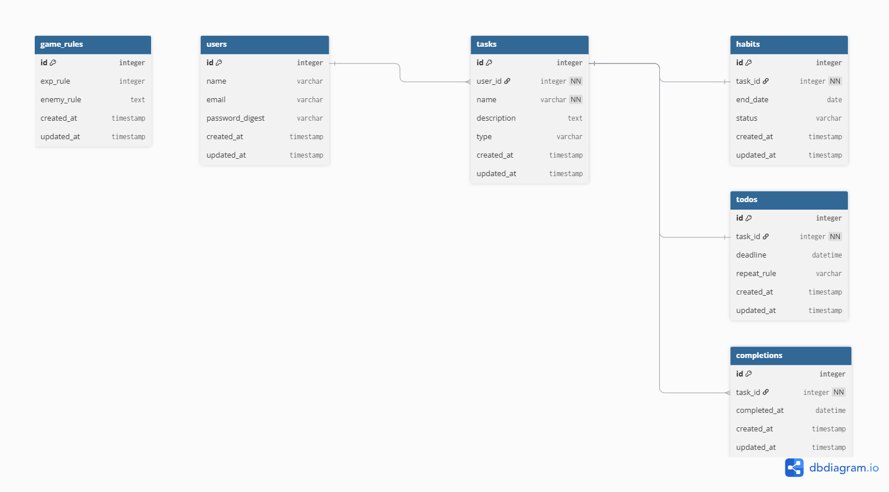

# Quest Log 🎮

## アプリ概要

Quest Logは、習慣化やTodo管理をゲーム感覚で楽しめるアプリです。

「やらなきゃいけないことは分かっているけど続かない」
「小さな達成を記録して、自分の成長を感じたい」

そんな人でも継続しやすいように、タスク管理と達成記録を組み合わせたアプリを制作しました。

---
## アプリURL
https://portforlio-quest-log.onrender.com
※ゲストユーザーでログインしてアプリを確認できます。

## 制作背景

私は、習慣化アプリやTodo管理アプリを使っても、入力や管理そのものが面倒になり、継続できない経験がありました。

そこで、最低限の操作で記録でき、ゲームのように「続けること」自体を楽しめるアプリを作成しました。

---

# 主な機能

## 👤 ユーザー機能

- ユーザー登録
- ログイン / ログアウト
- ゲストユーザーログイン

---

## ✅ Todo機能

期限や繰り返し設定ができるTodo管理機能です。

### 対応種類

- デイリー
- ウィークリー
- マンスリー
- 例外タスク

### 機能

- Todo作成
- Todo編集
- Todo削除
- 完了記録

---

## 🌱 Habit機能

継続したい習慣を管理する機能です。

### 状態管理

- 継続中
- 休息中
- 完了

### 機能

- Habit作成
- Habit編集
- Habit削除
- 達成回数表示
- 最大継続日数表示

---

## 🏆 達成記録機能

Completionモデルを使用して、タスクの達成履歴を保存しています。

保存したデータから、

- 完了回数
- 最大継続日数

を表示できます。

---

## アプリ画面

### トップ画面



### 習慣管理


### Todo管理



# ER図


---

# 使用技術

## Backend

- Ruby 4.0.3
- Ruby on Rails 7.2.2.1

## Database

- SQLite3

## Frontend

- HTML
- CSS
- JavaScript

## Gem

- Devise
- Active Storage
- rails-i18n
- reline
- fiddle
- devise-i18n

---

# データベース設計

## User

ユーザー情報を管理します。

```
User
 └ has_many :tasks
```

---

## Task

TodoとHabitの共通部分を管理します。

```
Task
 ├ belongs_to :user
 └ has_many :completions
```

---

## Habit

習慣情報を管理します。

```
Habit
 └ belongs_to :task
```

---

## TodoList

Todo情報を管理します。

```
TodoList
 └ belongs_to :task
```

---

## Completion

達成履歴を管理します。

```
Completion
 └ belongs_to :task
```

---

# 工夫した点

## Taskモデルによる共通化

TodoとHabitはどちらも「やること」を管理する機能のため、Taskモデルを作成しました。

共通部分をTaskにまとめることで、達成記録や継続日数計算を共通化しています。

---

## Completionによる履歴管理

単純に「完了済み」という状態を保存するのではなく、Completionモデルを作成しました。

これにより、

- いつ達成したか
- 何回達成したか
- どのくらい継続できたか

を管理できるようにしました。

---

## 最大継続日数計算

Completionの達成日時を利用して、連続して達成した日数を計算する処理を実装しました。

---

## ゲストユーザー機能

登録なしでもアプリを確認できるよう、ゲストログイン機能を実装しました。

ポートフォリオ閲覧者が簡単に機能を確認できます。

---


# 今後追加予定の機能

- レベルアップ機能
- 経験値システム
- 報酬システム
- グラフ表示
- 体調記録
- 生理周期管理
- キャラクター要素

---

# 開発期間

2026年7月 制作

---

# Author

Tuki toma